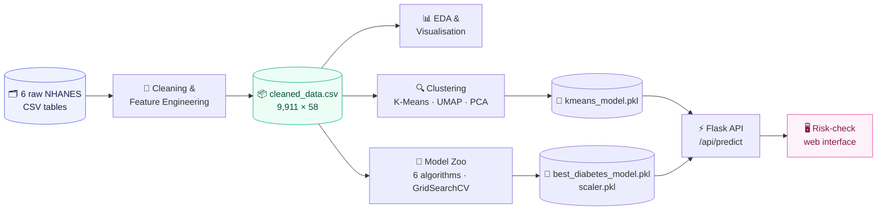
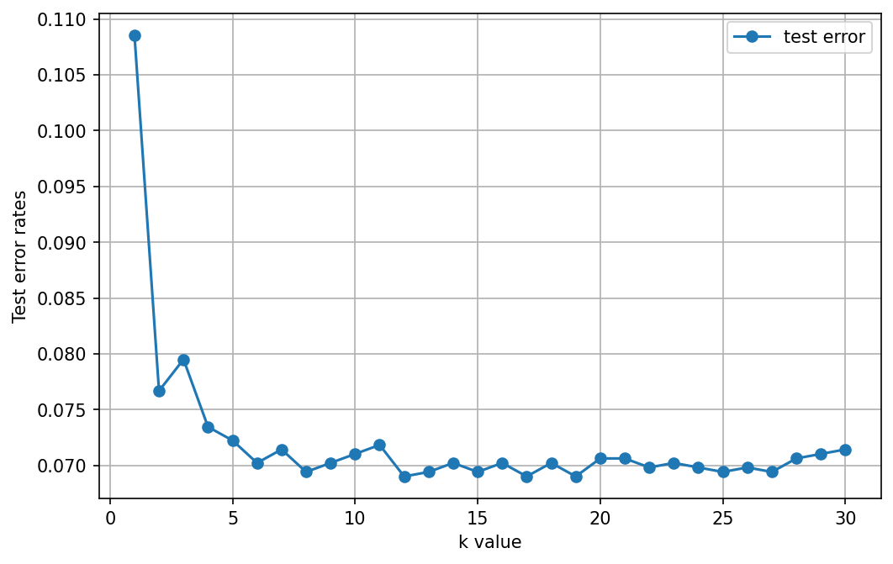
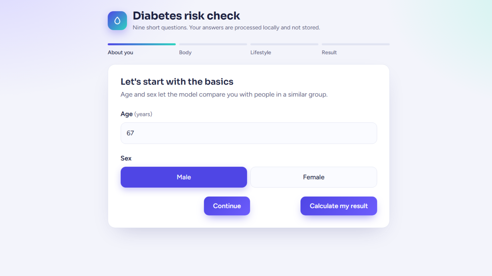
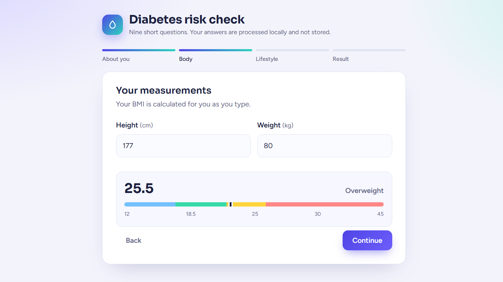
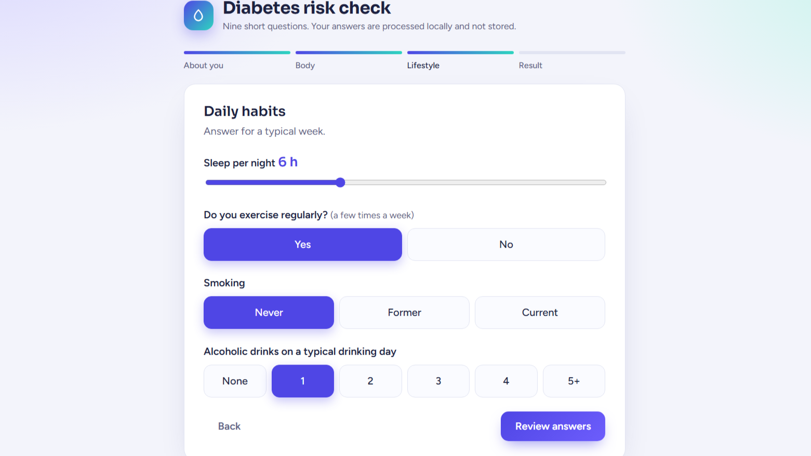
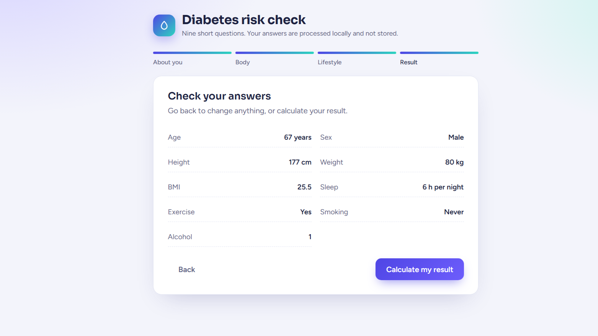
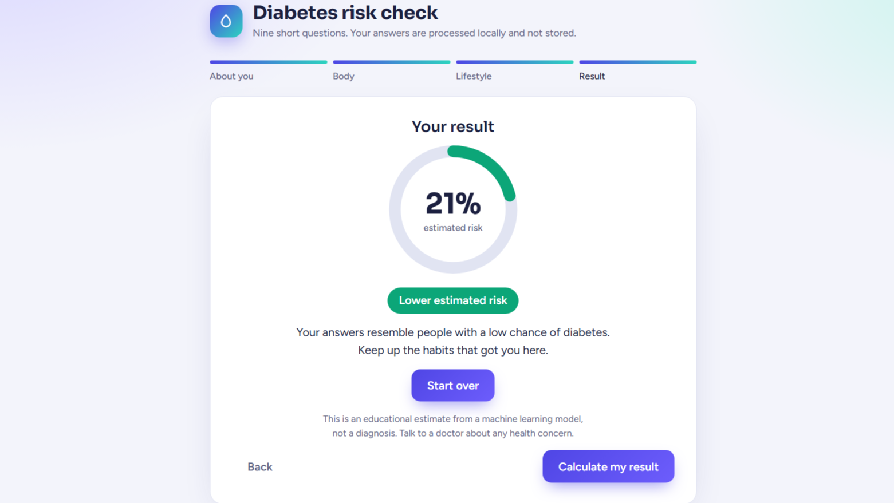

<div align="center">

# 🩸 LatentHealth

### Unsupervised patient phenotyping + supervised diabetes-risk scoring, served through a real-time web app.

*From six raw NHANES tables to a 9-question risk check, end to end.*

<br/>


<br/>

**[Overview](#-overview) · [Highlights](#-highlights) · [Pipeline](#-pipeline) · [Data](#-data) · [Insights](#-exploratory-insights) · [Clustering](#-patient-phenotyping) · [Modeling](#-predictive-modeling) · [Web App](#-web-app) · [Quickstart](#-quickstart) · [Roadmap](#-limitations--roadmap)**

</div>

---

## ✦ Overview

**LatentHealth** looks for the hidden structure in population health data. It combines two complementary views of the same patients:

| Lens | Question it answers | Technique |
|---|---|---|
| 🔍 **Unsupervised** | *Which natural patient groups exist in this population?* | MinMax scaling → K-Means (k = 4) → UMAP / PCA |
| 🎯 **Supervised** | *How likely is this person to have diabetes, given 9 easy-to-answer inputs?* | 6 classifiers · GridSearchCV · ROC-AUC |
| 🌐 **Deployed** | *Can a non-technical user get an answer in under a minute?* | Flask REST API + multi-step questionnaire UI |

The project is built on the **NHANES 2013–2014** survey (US CDC), merging **six raw tables** and **~1,800 raw columns** into one clean, model-ready dataset of **9,911 unique participants × 58 features**.

---

## ✦ Highlights

- 🧬 **Six-source data fusion**: demographics, diet, labs, examination, medications and questionnaire tables joined on `SEQN`.
- 🧹 **Principled cleaning**: 23 sparse or redundant columns dropped, NHANES sentinel codes (e.g. `77`, `777`) neutralised, domain-aware imputation.
- 🛠️ **Clinical feature engineering**: `physically_active`, `smoking_status`, `alcohol_use`, `sugar_ratio`, `fiber_density`, `satfat_ratio`, `any_medication`.
- 🤖 **Six models, 400+ cross-validated fits**: Logistic Regression, SVM, Decision Tree, Random Forest, Gradient Boosting and KNN, each tuned with 3-fold ROC-AUC grid search.
- 🗺️ **UMAP + PCA + elbow analysis** to inspect the latent geometry of the cohort.
- ⚡ **Production-style inference**: server-side validation, BMI computed on the server (never trusted from the browser), probability → risk-tier mapping.
- 🔒 **Privacy by design**: answers are processed in-memory and never stored.

---

## ✦ Pipeline



---

## ✦ Data

| Source table | Raw columns | Role |
|---|---:|---|
| `demographic.csv` | 47 | Age, sex, ethnicity, education, household & income |
| `diet.csv` | 168 | Calories, carbs, sugar, fibre, fat, saturated fat |
| `examination.csv` | 224 | Weight, height, BMI |
| `labs.csv` | 424 | HbA1c, insulin, triglycerides, cholesterol, haemoglobin |
| `medications.csv` | 13 | Prescription usage |
| `questionnaire.csv` | 953 | Diabetes status, activity, smoking, alcohol, sleep |

**Target:** `diabetes` = self-reported physician diagnosis (`DIQ010 == 1`).

| Metric | Value |
|---|---|
| Survey cycle | NHANES 2013–2014 |
| Unique participants | **9,911** |
| Final features | **58** |
| Diabetes prevalence (unique participants) | **≈ 7.3 %** (strong class imbalance) |
| Age range | 0 – 80 years |

<details>
<summary><b>🔧 Cleaning & feature-engineering steps (click to expand)</b></summary>

<br/>

1. **Select** relevant columns from each table and **left-merge** on `SEQN`.
2. **Sentinel handling**: `SLD010H ≥ 77` → `NaN`; `alcohol_use ≥ 777` → `NaN` → `0`; implausible alcohol (≥ 11 drinks/day) removed.
3. **Drop** 23 columns with excessive missingness or redundancy (e.g. `DMQADFC`, `DRQSDT4`, `LBDLDL`, `PAQ650`).
4. **Impute**
   - *Domain-aware constants* for questionnaire gaps ("No", "Unknown", "Not a smoker").
   - *Mean imputation* (`SimpleImputer`) for 28 continuous variables.
5. **Engineer**
   - `physically_active`: any vigorous or moderate activity.
   - `smoking_status`: 0 = never · 1 = former · 2 = current.
   - `alcohol_use`: drinks on a typical drinking day.
   - `sugar_ratio` = sugar / carbs · `fiber_density` = fibre / kcal · `satfat_ratio` = sat. fat / total fat.
   - `any_medication`: binary flag from the medication table.
6. **Label** `diabetes` from `DIQ010` and drop the source questionnaire columns that would leak it.

</details>

---

## ✦ Exploratory Insights

Balanced samples (4,000 diabetic + 4,000 non-diabetic) were used for the visual analysis.

<table>
<tr>
<td align="center" width="50%">
<br/>
<sub><b>BMI</b>: the diabetic cohort sits higher (median ≈ 30.6 vs 25.3 kg/m²).</sub>
</td>
<td align="center" width="50%">
<br/>
<sub><b>Smoking</b>: former smokers show the highest prevalence (≈ 17 % vs ≈ 5 % for never-smokers).</sub>
</td>
</tr>
<tr>
<td align="center">
<br/>
<sub><b>Physical activity</b> split by diabetes status.</sub>
</td>
<td align="center">
<br/>
<sub><b>Socio-economics</b>: prevalence across four household-income tiers.</sub>
</td>
</tr>
<tr>
<td align="center" colspan="2">
<br/>
<sub><b>Anthropometrics</b>: weight × height, coloured by diabetes status.</sub>
</td>
</tr>
</table>

> 🔬 **Strongest signals** (absolute correlation with the target): **HbA1c `LBXGH` (0.55)** → age (0.34) → medication use (0.32) → BMI (0.23). HbA1c's median sits at **6.8 %** in the diabetic group vs **5.7 %** otherwise, straddling the 6.5 % clinical threshold.

The notebook also covers alcohol consumption, sleep duration and the triglyceride × cholesterol relationship (`notebooks/virtualization.ipynb`).

---

## ✦ Patient Phenotyping

Unsupervised learning was used to see whether the cohort splits into meaningful groups *without* ever showing the model a label.

<table>
<tr>
<td align="center" width="50%">
<br/>
<sub><b>K-Means elbow</b>: inertia for k = 1…20.</sub>
</td>
<td align="center" width="50%">
<br/>
<sub><b>PCA</b>: explained variance vs components.</sub>
</td>
</tr>
<tr>
<td align="center">
<br/>
<sub><b>UMAP 2-D</b>: diabetic (red) patients concentrate toward the periphery of the embedding.</sub>
</td>
<td align="center">
<br/>
<sub><b>KNN</b>: test error vs <i>k</i>, used to sanity-check the neighbour count.</sub>
</td>
</tr>
</table>

**Methods compared:** DBSCAN (ε × min-samples sweep) → rejected (thousands of micro-clusters, up to ~60 % noise); **K-Means with k = 4** → selected.

### Resulting cohorts

| Cluster | Records | Diabetes prevalence | Reading |
|:---:|---:|:---:|---|
| **0** | 6,941 | **31.1 %** | 🔴 High-burden group |
| **1** | 3,159 | 0.7 % | 🟢 Very low-risk group |
| **2** | 4,205 | 0.4 % | 🟢 Very low-risk group |
| **3** | 5,085 | **39.0 %** | 🔴 Highest-burden group |

Two groups carry nearly all of the disease burden (31 % and 39 %), while the other two are close to zero, a clear separation recovered by an algorithm that was handed a diverse feature set. Full coordinates and labels live in `outputs/clustering_results.csv`.

> ℹ️ Counts are on the pre-deduplication table (19,390 rows), where multi-medication participants appear more than once.

---

## ✦ Predictive Modeling

**Inputs (9 features, all self-reportable):** age · sex · height · weight · BMI · sleep hours · physical activity · smoking status · alcohol use.
**Protocol:** stratified 75/25 split (`random_state=119`) → `StandardScaler` → 3-fold `GridSearchCV` on **ROC-AUC**.

### Cross-validated ROC-AUC per algorithm

| Rank | Model | Best CV ROC-AUC | Best hyper-parameters |
|:---:|---|:---:|---|
| 🥇 | Random Forest | **0.878** | `entropy`, depth 7, min-split 4 |
| 🥈 | Logistic Regression | 0.873 | `l2`, `liblinear` |
| 🥉 | Gradient Boosting | 0.871 | lr 0.2, 50 trees, `exponential` |
| 4 | Decision Tree | 0.808 | `gini`, depth 7, min-split 6 |
| 5 | KNN | 0.777 | k = 9, `distance`, `brute` |
| 6 | SVM | 0.773 | `poly`, degree 3 |

### Deployed model: tuned KNN, hold-out test set (n = 2,478)

| Class | Precision | Recall | F1 | Support |
|---|:---:|:---:|:---:|:---:|
| Non-diabetic | 0.93 | 0.99 | 0.96 | 2,296 |
| Diabetic | 0.42 | 0.09 | 0.15 | 182 |
| **Accuracy** | | | **0.92** | 2,478 |

Full 24-config KNN search results: [`outputs/grid_search_results.csv`](outputs/grid_search_results.csv).

---

## ✦ Web App

A guided, four-step questionnaire (*About you → Body → Lifestyle → Result*) backed by a JSON API. Output is a probability ring, a three-tier risk label and a plain-language message.

<table>
<tr>
<td></td>
<td></td>
<td></td>
</tr>
<tr>
<td></td>
<td></td>
<td align="center"><sub>Guided steps · live validation · instant risk gauge</sub></td>
</tr>
</table>

### API

```http
POST /api/predict
Content-Type: application/json
```

```json
{
  "age": 52, "sex": 1, "height": 175, "weight": 92,
  "sleep": 6, "active": 0, "smoking": 1, "alcohol": 2
}
```

```json
// illustrative response
{
  "probability": 0.2143,
  "level": "moderate",
  "bmi": 30.0,
  "cluster": null
}
```

| Field | Allowed values |
|---|---|
| `age` | 1 – 110 |
| `sex` | `1` male · `2` female (NHANES coding) |
| `height` / `weight` | 80 – 230 cm / 10 – 250 kg |
| `sleep` | 2 – 14 h |
| `active` | `0` no · `1` yes |
| `smoking` | `0` never · `1` former · `2` current |
| `alcohol` | `0` – `5` drinks on a typical day |

**Risk tiers:** `< 0.33` → low · `0.33 – 0.66` → moderate · `≥ 0.66` → high.

---

## ✦ Quickstart

```bash
# 1 · Clone
git clone https://github.com/ali-119/LatentHealth.git
cd LatentHealth

# 2 · Environment
python -m venv .venv && source .venv/bin/activate   # Windows: .venv\Scripts\activate
pip install -r requirements.txt

# 3 · Launch
python app.py
# → http://127.0.0.1:5000
```

> 📌 The pickled models were serialised with **scikit-learn 1.6.1**, so keep that exact version.

### Reproduce the research

```bash
jupyter lab
#  1. data/data_cleaning.ipynb          → data/cleaned_data.csv
#  2. notebooks/virtualization.ipynb    → EDA figures
#  3. notebooks/clusters.ipynb          → K-Means · UMAP · PCA
#  4. notebooks/ml_algorithms.ipynb     → model zoo · best_diabetes_model.pkl
```

---

## ✦ Project Structure

```text
LatentHealth/
├── app.py                      # Flask app + /api/predict
├── requirements.txt
├── templates/
│   └── questions.html          # Multi-step questionnaire UI
├── data/
│   ├── raw_data/               # 6 original NHANES tables
│   ├── cleaned_data.csv        # Model-ready dataset
│   └── data_cleaning.ipynb
├── notebooks/
│   ├── virtualization.ipynb    # Exploratory analysis
│   ├── clusters.ipynb          # Unsupervised learning
│   └── ml_algorithms.ipynb     # Supervised learning
├── models/
│   ├── best_diabetes_model.pkl
│   ├── scaler.pkl
│   ├── kmeans_model.pkl
│   └── grid_search_results.pkl
├── outputs/
│   ├── clustering_results.csv
│   ├── cluster_summary.csv
│   └── grid_search_results.csv
└── images/
    ├── data_plots/  ·  cluster_plot/  ·  tem/
```

---

## ✦ Limitations & Roadmap

Honest engineering notes, and the next steps that would take this from a strong prototype to a robust tool.

| Area | Current state | Next step |
|---|---|---|
| **Class imbalance** | ≈ 7 % positives → low recall (0.09) for the diabetic class | `class_weight='balanced'`, SMOTE, threshold tuning on a PR curve |
| **Model selection** | Deployed KNN; tree ensembles and Logistic Regression score higher CV ROC-AUC (≈ 0.87–0.88) | Re-export the top ROC-AUC model, add calibration (`CalibratedClassifierCV`) and PR-AUC |
| **Cluster serving** | K-Means was fit on the full 58-feature matrix; the app returns `cluster: null` until a compatible feature set is wired in | Re-train K-Means on the 9 questionnaire features and register `KMEANS_FEATURES` |
| **Cluster purity** | Label and identifier columns were present when scaling for clustering | Re-cluster on features only to confirm the cohort split holds |
| **Explainability** | None yet | SHAP summaries and per-user feature contributions |
| **Deployment** | Local Flask dev server | Docker image · Gunicorn · CI with model-version checks |

---

## ✦ Disclaimer

> ⚠️ **LatentHealth is an educational and research project. It is not a medical device and does not provide a diagnosis.** Results are statistical estimates learned from a public survey. Always consult a qualified healthcare professional about any health concern.

---

## ✦ Author

<div align="center">

**Ali**
*Data Science & Machine Learning Student*

[](https://github.com/ali-119)
[](mailto:ali.hz87980@gmail.com)

<br/>

Released under the [MIT License](LICENSE) · © 2025 Ali

⭐ *If this project helped you, consider giving it a star.*

</div>
